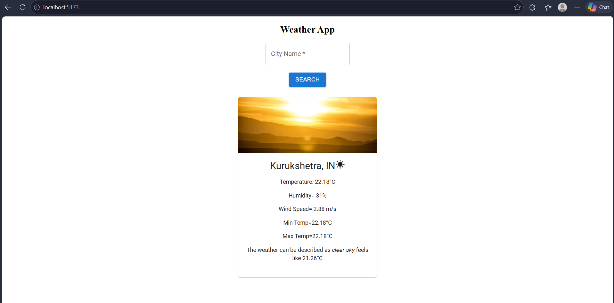

# 🌦️ Weather App

A modern and responsive Weather Application built using **React.js** and **Vite** that provides real-time weather updates for any city worldwide. The application fetches live weather data through an API and displays essential weather information in an intuitive and user-friendly interface.

## 🚀 Live Demo


---

## 📌 Features

- 🔍 Search weather by city name
- 🌡️ Real-time temperature updates
- ☁️ Weather condition display
- 💨 Wind speed information
- 💧 Humidity levels
- 📍 Dynamic city-based weather data
- 📱 Fully responsive design
- ⚡ Fast performance powered by Vite

---

## 🛠️ Tech Stack

### Frontend
- React.js
- Vite
- JavaScript (ES6+)
- CSS3

### API
- OpenWeather API *(or the API you used)*

---

## 📂 Project Structure

```bash
weather-app-miniproject/
│
├── public/
│
├── src/
│   ├── assets/
│   ├── App.jsx
│   ├── main.jsx
│   └── index.css
│
├── .env
├── package.json
├── vite.config.js
└── README.md
```

---

## ⚙️ Installation

### 1. Clone the Repository

```bash
git clone https://github.com/Kirti391/weather-app-miniproject.git
```

### 2. Navigate to the Project Folder

```bash
cd weather-app-miniproject
```

### 3. Install Dependencies

```bash
npm install
```

### 4. Configure Environment Variables

Create a `.env` file in the project root and add:

```env
VITE_WEATHER_API_KEY=YOUR_API_KEY
```

### 5. Run the Application

```bash
npm run dev
```

Application will start on:

```bash
http://localhost:5173
```

---

## 📸 Preview

Add your application screenshot here.

```md

```

---

## 🌍 Weather Information Displayed

The application provides:

- City Name
- Current Temperature
- Weather Condition
- Weather Icon
- Humidity
- Wind Speed
- Country Information

---

## 🎯 Learning Outcomes

This project helped in understanding:

- API Integration in React
- React Hooks (`useState`, `useEffect`)
- Environment Variables in Vite
- Asynchronous JavaScript (Fetch API)
- Component-Based Architecture
- Responsive UI Design

---

## 🔮 Future Improvements

- 5-Day Forecast Feature
- Current Location Weather Detection
- Dark/Light Mode Toggle
- Weather History Search
- Air Quality Index (AQI)
- Hourly Forecast

---

## 🤝 Contributing

Contributions, issues, and feature requests are welcome.

1. Fork the repository
2. Create a new branch

```bash
git checkout -b feature-name
```

3. Commit your changes

```bash
git commit -m "Add new feature"
```

4. Push to GitHub

```bash
git push origin feature-name
```

5. Open a Pull Request

---

## 👨‍💻 Author

**Kirti**

- GitHub: [@Kirti391](https://github.com/Kirti391)

---

## ⭐ Support

If you found this project helpful, please consider giving it a ⭐ on GitHub.

---

## 📄 License

This project is licensed under the MIT License.
